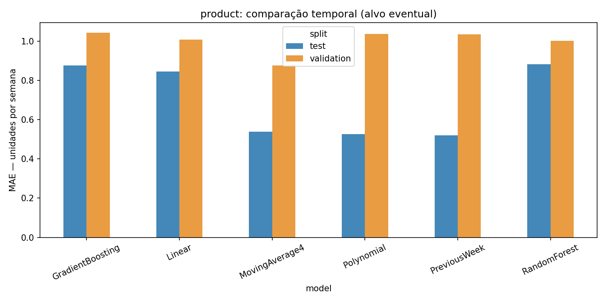
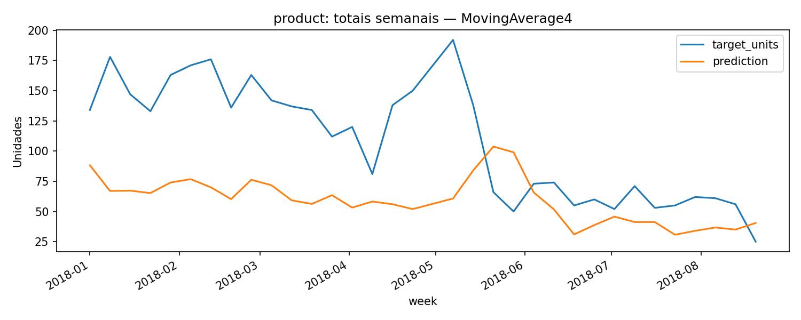
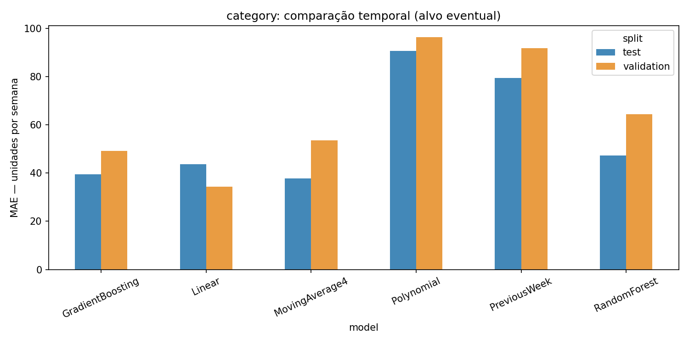
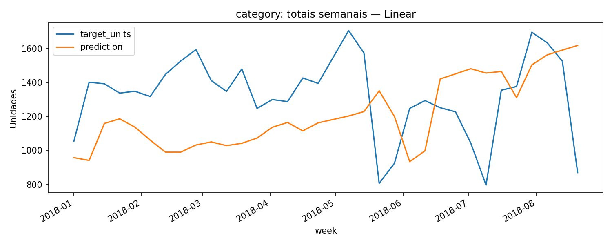

# Modelagem — Motor de Precificação Dinâmica para Marketplace

Dupla: **Danylo e William**. Execução real em 19/09/2026. Experimento principal produto-semana; categoria-semana auxiliar. Não foram implementados API, interface ou motor de preços.

## Definição do alvo e disponibilidade temporal

O alvo `target_units` **continua sendo o número de itens de pedidos que terminaram entregues, agrupados pela semana da compra**. Não foi trocado por valor monetário, preço, total de pedidos de qualquer status ou quantidade de entregas realizadas naquela semana.

Há, porém, uma diferença obrigatória entre o alvo eventual e aquilo que era conhecido na data histórica. O CSV contém status final e data de entrega. Não é possível usar uma entrega futura para construir atributos passados nem treinar em janeiro com confirmações de fevereiro. Por isso:

- `target_units` preserva a contagem eventual e é usado somente para avaliação retrospectiva.
- `label_available_train` conta, para cada semana de compra, apenas itens entregues antes de **01/01/2018**. É o rótulo efetivamente usado no ajuste.
- `label_available_selection` conta apenas entregas anteriores a **01/05/2018**. É o rótulo de validação utilizado para selecionar o campeão.
- Esses dois rótulos são observações **censuradas à direita do mesmo alvo**, não alvos perfeitamente completos. A diferença é quantificada abaixo. Isso impõe viés, sobretudo nas semanas próximas aos cortes; não foi ocultado nem corrigido usando futuro.
- Na avaliação retrospectiva de validação e teste, os resultados entregues posteriormente podem ser usados como verdade de referência, mas nunca são fornecidos ao ajuste ou à decisão de qual modelo salvar.

As métricas principais abaixo usam o alvo eventual. As métricas com rótulo disponível são salvas separadamente e apresentadas para a seleção. Não alegamos uma comparação operacional sem censura. Uma extensão metodológica poderá definir explicitamente um alvo de horizonte fixo de confirmação ou uma política de maturação, exigindo nova versão do experimento.

## Construção e seleção

O pipeline parte dos CSVs de pedidos, itens e produtos. Itens são unidades, e não a soma do identificador sequencial `order_item_id`. Junções muitos-para-um são verificadas. Categoria estática é uma hipótese: o catálogo não possui histórico de versões.

Produtos: pelo menos 20 pedidos, 8 semanas com venda e 2 preços distintos nas compras de 2017, **com entregas conhecidas antes de janeiro de 2018**. Categorias auxiliares: pelo menos 90% de semanas com vendas e mediana de 20 unidades/semana, somente no treino e com o mesmo corte de confirmação. Nenhum filtro depende de validação/teste.

Resultado: **136 produtos**, contra os 149 da auditoria retrospectiva anterior. A diferença decorre do corte de confirmação, não de uma busca por desempenho. O experimento auxiliar inclui **14 categorias**.


O painel é preenchido em todas as semanas, mesmo sem transação. Zero significa **nenhum item entregue registrado para aquela semana de compra na versão avaliada**, não estoque disponível nem demanda latente zero. `availability_state=unknown` documenta isso. Preço ausente não é preenchido com preço futuro. O último preço conhecido tem idade e sinalizador explícitos; imputação mediana é ajustada no treino. Não se cria estoque, concorrência ou custo.

Há quatro semanas iniciais de aquecimento, excluídas para todos os métodos. O catálogo elegível é fixado ao final de 2017, e as features anteriores são reconstruídas ponto no tempo. Trata-se de um benchmark retrospectivo com universo escolhido no treino, não da simulação de um catálogo que já era conhecido em janeiro de 2017.

## Features e exclusões

São **19 features numéricas e uma categórica**, idênticas entre os quatro modelos, com expansão de grau 2 apenas nas numéricas da regressão polinomial. `entity_id`, alvos, flags de avaliação, datas máximas de origem e status de disponibilidade não entram no modelo. Categoria não é convertida em número ordinal.

| Feature | Definição / disponibilidade |
| --- | --- |
| category | Categoria estática do produto, obtida em registros de treino; one-hot aprendido no treino. |
| units_lag_1 / 2 / 4 | Itens comprados 1, 2 ou 4 semanas antes, com entrega confirmada antes da previsão. |
| units_mean_4w / units_std_4w | Média e desvio populacional dessas contagens nas quatro semanas anteriores. |
| active_weeks_8w | Semanas anteriores com entrega já conhecida de alguma compra daquela semana. |
| weeks_since_last_sale | Distância à semana da última compra cuja entrega já era conhecida. |
| last_observed_price | Mediana da última semana com transações entregues já conhecidas; não é oferta atual. |
| price_age_weeks | Distância à semana desse preço histórico. |
| price_missing | Ausência de preço histórico disponível; não indica ausência de oferta. |
| price_change_last_observed | Variação relativa entre as duas últimas medianas semanais disponíveis. |
| freight_median_lag | Mediana de frete das compras das quatro semanas anteriores já entregues. |
| sellers_count_4w | Vendedores dessas transações nas quatro semanas anteriores. |
| category_units_lag_1 / category_units_mean_4w | Contexto da categoria: contagem anterior e média de quatro semanas, sob o mesmo corte de disponibilidade. |
| week_sin / week_cos | Calendário da semana a prever, conhecido previamente; periodicidade de 52,18 semanas. |
| time_index / history_weeks | Semanas desde o começo fixo do painel. Redundantes neste recorte; documentadas como limitação da especificação inicial. |

Todas as variáveis transacionais usam `purchase < week_start` e `delivery < week_start`. Até os preços são extraídos somente desse subconjunto confirmado: é uma política conservadora, que evita depender do status final futuro. Calendário da semana-alvo é conhecido antecipadamente e não usa transações daquela semana.

## Divisão temporal

Semanas de segunda a domingo. A semana de **30/04–06/05/2018** atravessa o corte e fica excluída como amostra supervisionada, evitando classificar compras de maio como validação. Ela pode compor histórico de previsões seguintes depois que suas transações se tornam disponíveis. A semana parcial final de agosto não entra. Treino permanece em 2017, validação em janeiro–abril e teste em maio–agosto.

Avaliação rolling-origin de um passo: a cada semana, pode-se incorporar histórico já disponível de semanas anteriores de validação/teste; os parâmetros e transformações ficam congelados no treino. Isso não equivale a prever quatro meses de uma só vez.


### product

| split | rows | weeks | start | end_week_start | target_units | zero_fraction | available_label_units |
| --- | --- | --- | --- | --- | --- | --- | --- |
| test | 2176 | 16 | 2018-05-07 | 2018-08-20 | 1143 | 0.8143 | nan |
| train | 6528 | 48 | 2017-01-30 | 2017-12-25 | 7625 | 0.5915 | 7217.0000 |
| validation | 2312 | 17 | 2018-01-01 | 2018-04-23 | 2415 | 0.6570 | 2148.0000 |

### category

| split | rows | weeks | start | end_week_start | target_units | zero_fraction | available_label_units |
| --- | --- | --- | --- | --- | --- | --- | --- |
| test | 224 | 16 | 2018-05-07 | 2018-08-20 | 20319 | 0.0000 | nan |
| train | 672 | 48 | 2017-01-30 | 2017-12-25 | 38056 | 0.0000 | 35995.0000 |
| validation | 238 | 17 | 2018-01-01 | 2018-04-23 | 23304 | 0.0000 | 21181.0000 |

`available_label_units` quantifica quanto do alvo já estava confirmado no corte. `zero_fraction` é a proporção de células sem venda registrada no alvo eventual. Datas da tabela representam o início da primeira e da última semana de cada conjunto.

## Referências, modelos e comparação justa

- **PreviousWeek**: contagem disponível da semana de compra anterior. O atraso de confirmação pode subestimar vendas recentes.
- **MovingAverage4**: média disponível das quatro semanas anteriores.
- **Linear**: regressão linear, numéricas padronizadas e categoria one-hot.
- **Polynomial**: regressão linear sobre termos numéricos de grau 2, com padronização; categoria one-hot sem expansão polinomial. Sem busca de graus.
- **RandomForest**: 200 árvores, profundidade máxima 8, mínimo 5 amostras por folha, semente 42.
- **GradientBoosting**: 150 árvores, taxa 0,05, profundidade 2, mínimo 10 amostras por folha, perda quadrática, semente 42.

Mesmas linhas, features e rótulos para os quatro modelos; baselines usam o mesmo histórico disponível. Imputação e codificação são aprendidas somente no treino. Predições negativas são truncadas em zero para todos; quantidades esperadas não são arredondadas. Sem tuning, sem retreino em validação, sem refit final. MAE é o critério primário; RMSE e nome desempatam. Baselines participam da escolha: um modelo complexo não é automaticamente campeão.

## Resultados retrospectivos reais

MAE e RMSE em unidades por entidade-semana. R² pode ser negativo e não é definido em grupos constantes; nesses grupos fica vazio nos CSVs.


### product: validação e teste, alvo eventual

| model | split | n | MAE | RMSE | R2 |
| --- | --- | --- | --- | --- | --- |
| PreviousWeek | validation | 2312 | 1.0350 | 2.6846 | -0.1629 |
| PreviousWeek | test | 2176 | 0.5207 | 2.0509 | -0.0571 |
| MovingAverage4 | validation | 2312 | 0.8760 | 2.2064 | 0.2145 |
| MovingAverage4 | test | 2176 | 0.5381 | 1.9778 | 0.0169 |
| Linear | validation | 2312 | 1.0075 | 2.1335 | 0.2655 |
| Linear | test | 2176 | 0.8456 | 1.9867 | 0.0081 |
| Polynomial | validation | 2312 | 1.0368 | 2.6864 | -0.1645 |
| Polynomial | test | 2176 | 0.5253 | 2.0628 | -0.0693 |
| RandomForest | validation | 2312 | 1.0017 | 2.2049 | 0.2156 |
| RandomForest | test | 2176 | 0.8825 | 1.8749 | 0.1165 |
| GradientBoosting | validation | 2312 | 1.0421 | 2.1608 | 0.2466 |
| GradientBoosting | test | 2176 | 0.8764 | 1.8792 | 0.1125 |




### product: seleção com informação disponível em 01/05/2018

| model | MAE | RMSE |
| --- | --- | --- |
| MovingAverage4 | 0.8007 | 1.8374 |
| Polynomial | 0.9213 | 2.3066 |
| PreviousWeek | 0.9239 | 2.3077 |
| RandomForest | 0.9367 | 1.8324 |
| Linear | 0.9557 | 1.7822 |
| GradientBoosting | 0.9944 | 1.8114 |

Campeão: **MovingAverage4**. Melhor entre os quatro modelos treinados: **Polynomial**. Artefatos: `artifacts/product/chosen_model.joblib` e `best_ml_model.joblib`. O campeão contém configuração, lista de features, estimador ou regra de baseline e política de truncamento.





### category: validação e teste, alvo eventual

| model | split | n | MAE | RMSE | R2 |
| --- | --- | --- | --- | --- | --- |
| PreviousWeek | validation | 238 | 91.8529 | 104.6133 | -3.0380 |
| PreviousWeek | test | 224 | 79.4643 | 94.2668 | -1.8921 |
| MovingAverage4 | validation | 238 | 53.4664 | 64.7652 | -0.5477 |
| MovingAverage4 | test | 224 | 37.8460 | 50.5293 | 0.1690 |
| Linear | validation | 238 | 34.2880 | 47.8551 | 0.1550 |
| Linear | test | 224 | 43.5983 | 53.4178 | 0.0713 |
| Polynomial | validation | 238 | 96.2894 | 109.7912 | -3.4477 |
| Polynomial | test | 224 | 90.7098 | 106.3057 | -2.6779 |
| RandomForest | validation | 238 | 64.4834 | 82.3555 | -1.5025 |
| RandomForest | test | 224 | 47.1911 | 64.4750 | -0.3529 |
| GradientBoosting | validation | 238 | 49.1683 | 65.1865 | -0.5679 |
| GradientBoosting | test | 224 | 39.5771 | 51.8831 | 0.1239 |




### category: seleção com informação disponível em 01/05/2018

| model | MAE | RMSE |
| --- | --- | --- |
| Linear | 34.8061 | 48.3010 |
| GradientBoosting | 46.4875 | 62.2368 |
| MovingAverage4 | 48.9244 | 61.0816 |
| RandomForest | 58.3375 | 76.7763 |
| PreviousWeek | 82.9580 | 97.8527 |
| Polynomial | 87.3692 | 102.5486 |

Campeão: **Linear**. Melhor entre os quatro modelos treinados: **Linear**. Artefatos: `artifacts/category/chosen_model.joblib` e `best_ml_model.joblib`. O campeão contém configuração, lista de features, estimador ou regra de baseline e política de truncamento.




## Diagnóstico crítico da regressão polinomial

No produto-semana, **2.287 de 2.312 previsões de validação** e **todas as 2.176 de teste** foram negativas antes do truncamento. No teste, o modelo retorna zero em todas as linhas após a regra comum. No auxiliar, todas as 224 previsões de teste também são truncadas para zero. Isso é uma falha de extrapolação/generalização, não sucesso preditivo. A posição de Polynomial como melhor ML por MAE disponível no produto é favorecida pela abundância de zeros; o artefato `best_ml_model.joblib` preserva o experimento, mas **não é recomendado para uso**.

RandomForest por categoria apresenta MAE eventual de treino 11,14 contra 64,48 na validação: sinal forte de perda de generalização, compatível com overfitting e mudança temporal. O comportamento polinomial e as redundâncias de atributos deverão ser tratados em uma nova rodada pré-especificada; não ajustamos o experimento após observar o teste.

Na análise auxiliar, Linear é escolhido pela validação, mas a média móvel supera seu MAE no teste (37,85 contra 43,60). O campeão não foi trocado após ver o teste.

## Erros por produto, categoria e atividade


Maiores MAEs de teste do campeão product:
| entity_id | n | actual_units | MAE | RMSE | R2 |
| --- | --- | --- | --- | --- | --- |
| 53b36df67ebb7c41585e8d54d6772e08 | 16 | 82 | 9.2344 | 14.9910 | -0.4036 |
| d285360f29ac7fd97640bf0baef03de0 | 16 | 65 | 4.9375 | 10.5582 | -0.2293 |
| e0d64dcfaa3b6db5c54ca298ae101d05 | 16 | 60 | 2.9844 | 4.9949 | -0.4106 |
| d1c427060a0f73f6b889a5c7c61f2ac4 | 16 | 61 | 2.9688 | 3.7500 | -0.8997 |
| 99a4788cb24856965c36a24e339b6058 | 16 | 59 | 2.7812 | 3.2137 | -0.4829 |

Semanas com e sem venda registrada:
| no_recorded_sale | n | MAE | RMSE | R2 |
| --- | --- | --- | --- | --- |
| False | 404 | 2.0749 | 3.9820 | -0.0632 |
| True | 1772 | 0.1878 | 1.0902 | nan |

Maiores MAEs de teste do campeão category:
| entity_id | n | actual_units | MAE | RMSE | R2 |
| --- | --- | --- | --- | --- | --- |
| beleza_saude | 16 | 3014 | 87.6953 | 99.3196 | -3.6263 |
| cool_stuff | 16 | 456 | 69.3025 | 71.2091 | -47.7571 |
| utilidades_domesticas | 16 | 2231 | 58.2062 | 67.6381 | -2.3149 |
| brinquedos | 16 | 680 | 51.9197 | 54.5997 | -30.0534 |
| ferramentas_jardim | 16 | 707 | 49.1110 | 54.7443 | -8.9433 |

Semanas com e sem venda registrada:
| no_recorded_sale | n | MAE | RMSE | R2 |
| --- | --- | --- | --- | --- |
| False | 224 | 43.5983 | 53.4178 | 0.0713 |

CSV de erros de **todos os seis métodos**, separados por validação/teste: `product_errors_by_entity_id.csv`, `product_errors_by_category.csv`, `category_errors_by_entity_id.csv`, `category_errors_by_category.csv`. Eles incluem contagem de linhas, volume real, viés médio, MAE, RMSE e R². Erros segmentados por atividade evitam que o grande número de zeros esconda falhas nas semanas com vendas.

## Generalização e possíveis sinais de overfitting

A tabela abaixo usa a mesma verdade eventual no treino, validação e teste. O treino foi ajustado com rótulos disponíveis, portanto estes erros não são exatamente o objetivo minimizado pelo ajuste; os erros contra rótulos de treino estão também em `model_metrics.csv`.


product:
| model | test | train | validation |
| --- | --- | --- | --- |
| GradientBoosting | 0.8764 | 1.0894 | 1.0421 |
| Linear | 0.8456 | 1.1303 | 1.0075 |
| MovingAverage4 | 0.5381 | 1.0080 | 0.8760 |
| Polynomial | 0.5253 | 1.0851 | 1.0368 |
| PreviousWeek | 0.5207 | 1.1523 | 1.0350 |
| RandomForest | 0.8825 | 0.9717 | 1.0017 |

Para Polynomial, MAE de treino 1.0851, validação 1.0368 e teste 0.5253. Diferenças devem ser interpretadas junto à queda/mudança no volume de vendas e à censura dos rótulos. Um teste melhor que o treino também pode refletir mais semanas sem transações, e não melhoria do modelo.


category:
| model | test | train | validation |
| --- | --- | --- | --- |
| GradientBoosting | 39.5771 | 12.8570 | 49.1683 |
| Linear | 43.5983 | 16.4970 | 34.2880 |
| MovingAverage4 | 37.8460 | 28.9174 | 53.4664 |
| Polynomial | 90.7098 | 14.0158 | 96.2894 |
| PreviousWeek | 79.4643 | 53.4688 | 91.8529 |
| RandomForest | 47.1911 | 11.1416 | 64.4834 |

Para Linear, MAE de treino 16.4970, validação 34.2880 e teste 43.5983. Diferenças devem ser interpretadas junto à queda/mudança no volume de vendas e à censura dos rótulos. Um teste melhor que o treino também pode refletir mais semanas sem transações, e não melhoria do modelo.


Comparar especialmente Polynomial e RandomForest entre treino e períodos posteriores: erro de treino baixo com piora fora dele é sinal compatível com overfitting. A expansão polinomial pode extrapolar mal no tempo, especialmente com atributos correlacionados (`time_index` e `history_weeks` são redundantes). Nenhum resultado de teste foi usado para alterar hiperparâmetros ou substituir o campeão.

## Limitações e recomendação

1. Previsão de vendas observadas não mede demanda latente, disponibilidade ou elasticidade causal. Não há base para concluir preço ótimo ou ganho real de receita.
2. Rótulos de treino/seleção têm atraso de confirmação explicitamente quantificado. Categorias e produtos possuem inatividade e possível saída do catálogo desconhecida. Entregas sem timestamp são excluídas das features disponíveis, embora possam estar no alvo retrospectivo.
3. O universo restrito favorece produtos recorrentes do treino, não produtos novos. Alterações do mix afetam o experimento auxiliar por categoria.
4. Mais acurácia agregada não garante bom desempenho em semanas com vendas ou em cada produto. Os CSVs segmentados devem orientar a próxima decisão.
5. Não há validação causal de preços, intervalos de previsão nem teste de significância entre modelos; há uma comparação temporal inicial de configuração fixa.

O próximo passo deve ser discutir estes resultados e a política de maturação antes de construir o motor de preços. O artefato salvo é um preditor experimental de vendas, não um precificador validado. Esta etapa termina aqui, sem FastAPI ou Streamlit.

## Reprodução e verificações

```bash
python3 -m venv .venv
.venv/bin/python -m pip install -r requirements-modeling.txt
.venv/bin/python scripts/modeling.py
.venv/bin/python -m unittest discover -s tests -v
.venv/bin/python scripts/report_modeling.py
```

Dependências congeladas; semente 42; hashes dos CSVs e do script em `artifacts/run_manifest.json`. Parâmetros completos em `artifacts/{product,category}/parameters.json`. Matrizes finais em `data/processed/{product,category}_week_features.csv`; métricas em `reports/model_metrics.csv` e `artifacts/{product,category}/metrics.csv`; previsões individuais em `artifacts/{product,category}/predictions.csv`.

Testes verificam: transações futuras não alteram features passadas; compra antiga com entrega futura não aparece no histórico; corte estrito de disponibilidade; exclusão de semana que cruza o corte; semântica explícita de zero e rótulo censurado. O pipeline verifica ainda datas máximas de origem e equivalência das previsões após salvar/recarregar o campeão. Logs reais em `artifacts/tests.log` e `artifacts/run.log`.
