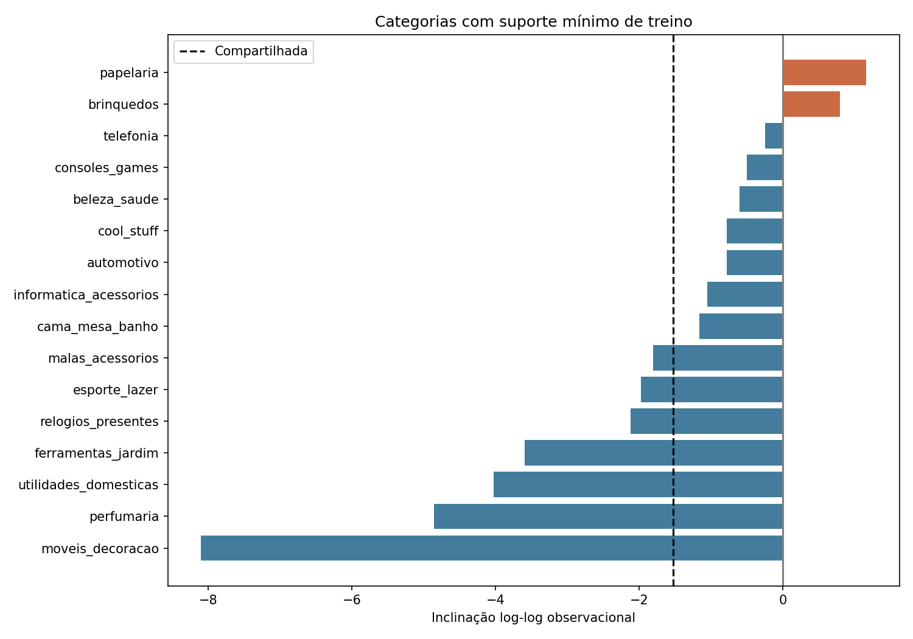
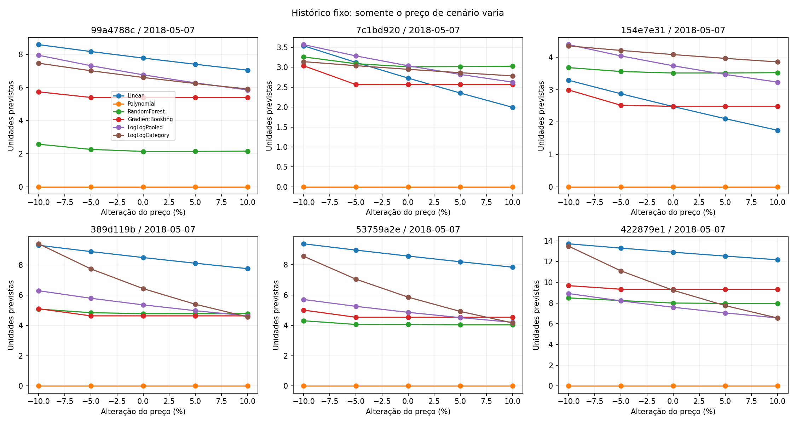
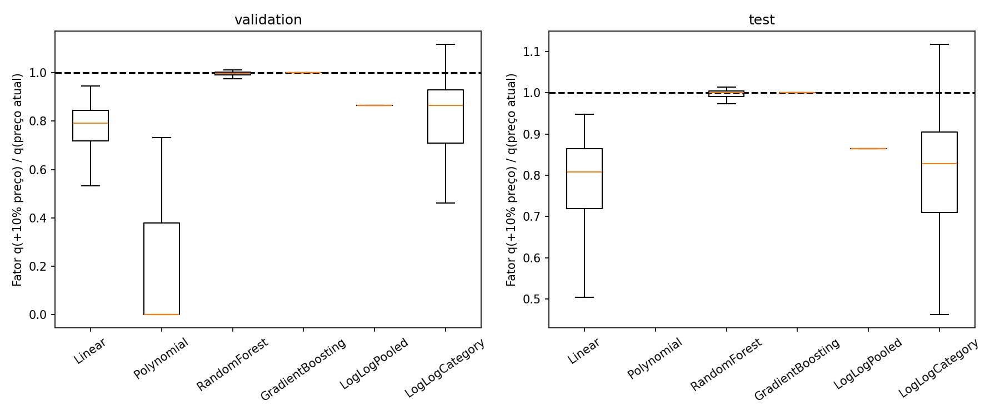

# Resposta ao preço — etapa independente

**Danylo e William — Tema 7. Execução em 19/09/2026.**

## Parecer

Há associação observacional negativa no ajuste log-log compartilhado, mas **não há evidência suficiente para fornecer uma curva confiável para cada produto nem para declarar validado um motor de precificação**. O melhor candidato pela regra predefinida de MAE de validação disponível foi **LogLogPooled**, com vantagem mínima sobre RandomForest. Ele foi escolhido pelas métricas, não por ter inclinação negativa. Não houve imposição de monotonicidade.

O campeão de previsão de demanda continua sendo **MovingAverage4**. A verificação de hashes confirmou **51 arquivos anteriores preservados**, incluindo scripts, matrizes, relatórios e artefatos. Nenhum arquivo da primeira etapa foi substituído. Os novos resultados estão exclusivamente em `artifacts/price_response/`, `data/processed/price_response/`, `reports/price_response/` e neste relatório, com scripts próprios.

O artefato `predictive_candidate.joblib` está marcado **experimental_not_approved_for_pricing**. É um candidato para pesquisa e demonstração explicitamente hipotética, não uma promoção para o motor de preços.

## Amostra, alvo e cortes

Foram reutilizados os **136 produtos elegíveis congelados em artifacts/selection.json**, sem selecionar novos produtos pelo futuro. O alvo permanece o número de itens de pedidos entregues agrupados pela semana da compra. Esta etapa condiciona a amostra a uma semana com transação e preço positivo observado. Quantidade não é estoque nem demanda latente.

Dos 11016 registros do painel após aquecimento e exclusão da fronteira, 3864 tinham venda eventual. Foram excluídas 232 semanas ativas sem preço histórico conhecido para formar a razão de preços; não inventamos referência. Assim, diferenças de erro em relação à primeira etapa **não são comparações diretas**: a população mudou para semanas ativas.


| coorte | rows | products | categories |
| --- | --- | --- | --- |
| train_available | 2370 | 136 | 28 |
| validation_available | 735 | 106 | 25 |
| validation | 793 | 106 | 25 |
| test | 404 | 69 | 24 |

Treino: semanas de 30/01 a 25/12/2017; validação: 01/01 a 23/04/2018; teste: 07/05 a 20/08/2018. Datas são segundas-feiras. As quatro semanas iniciais são aquecimento. A semana 30/04–06/05 foi excluída das amostras supervisionadas por cruzar os períodos, como no experimento anterior; pode integrar o histórico quando já passada e confirmada.

O treino usa **somente quantidade e mediana de preço dos itens cuja entrega já estava confirmada antes de 01/01/2018**, exigindo quantidade positiva nesse corte. A escolha usa a coorte positiva e os preços conhecidos antes de 01/05/2018. São rótulos censurados por atraso de confirmação, como documentado anteriormente. As métricas retrospectivas de validação/teste usam vendas eventualmente entregues e o preço realizado dessas vendas; isso só é permitido aqui como análise condicional e cenário retrospectivo, não como informação operacional disponível no início da semana.

Treino, imputação, escalas, codificação, limites de suporte e estimativas de elasticidade usam somente o treino. Os modelos não foram reajustados em validação ou teste. A avaliação é semanal de um passo com histórico já disponível, não previsão simultânea de quatro meses.

## Preço de cenário e features

A única informação contemporânea permitida é a **mediana do preço realizado dos itens da própria semana**, chamada `scenario_price`. É um proxy de preço praticado, não uma oferta observada continuamente; mistura potenciais vendas em preços e vendedores diferentes. A seleção da amostra por atividade e esse preço transacionado estão sujeitos a viés de seleção e simultaneidade.

| Campo de cenário | Definição |
| --- | --- |
| scenario_price | Mediana realizada; na futura simulação, preço candidato informado |
| price_ratio_to_last_observed | scenario_price / último preço histórico disponível |
| price_change_pct | 100 × (razão − 1) |
| log_price_ratio | log natural da razão |

Os quatro campos são materializados. Para evitar duplicação algébrica, os quatro modelos usam **log_price_ratio** como entrada do cenário e **log_last_observed_price** como escala histórica. Durante a grade, todos os campos derivados do preço são recalculados coerentemente. O log-log utiliza log(scenario_price).

Histórico reutilizado, com compra e confirmação de entrega estritamente anteriores à semana-alvo:

- `units_lag_1`, `units_lag_2`, `units_lag_4`;
- `units_mean_4w`, `units_std_4w`, `active_weeks_8w`, `weeks_since_last_sale`;
- `price_age_weeks`, `log_last_observed_price`;
- `category_units_lag_1`, `category_units_mean_4w`;
- `week_sin`, `week_cos`, `time_index`;
- produto e categoria codificados a partir do treino.

O calendário futuro é conhecido previamente. Categoria é estática no catálogo e sua atribuição foi congelada no treino. **Não entram pedidos, quantidade vendida, vendedores, frete ou qualquer agregado da própria semana**, exceto o preço autorizado. Não usamos preços de semanas sem venda, não fabricamos estoque ou concorrência e não incluímos zero-venda na avaliação desta etapa.

## Modelos e critérios fixados

Todos os modelos principais são compartilhados entre produtos, com identidade de produto e categoria codificadas no treino. Numéricas têm imputação mediana e padronização ajustadas no treino. Atributos ausentes não são preenchidos com dados futuros.

- Linear: mínimos quadrados com intercepto.
- Polynomial: expansão numérica de grau 2 com **Ridge alpha=1**, fixado antes de executar esta etapa para estabilizar termos correlacionados; não modifica a polinomial antiga. Não houve busca de alpha ou grau.
- RandomForest: 200 árvores, profundidade 8, mínimo 5 exemplos por folha, semente 42.
- GradientBoosting: 150 árvores, taxa 0,05, profundidade 2, mínimo 10 exemplos por folha, semente 42.
- LogLogPooled: log(quantidade) = intercepto do produto + beta × log(preço), com beta compartilhado, estimado pela variação dentro dos produtos.
- LogLogCategory: mesma forma, com inclinação própria apenas para categorias com ≥40 observações, ≥3 produtos e soma de quadrados within de log(preço) >0,01 no treino. Demais categorias usam a inclinação compartilhada.

Não há restrição de sinal ou monotonicidade. Para contagens, os modelos gerais são truncados em zero; negativos brutos são registrados e sinalizados. No log-log, usamos exp da previsão sem smearing: a escala retorna uma mediana geométrica condicional, não uma média aritmética corrigida. Isso limita a comparação e é relevante para receita esperada. No fator relativo log-log, o intercepto se cancela.

Critério de escolha entre os seis candidatos: menor MAE da validação com rótulo disponível antes de maio, desempate por RMSE e nome. O teste foi usado apenas para diagnóstico. Todos os seis artefatos permanecem disponíveis.

## Métricas reais — somente semanas ativas

MAE e RMSE são unidades por produto-semana. R² negativo significa desempenho pior que a referência constante usada por essa métrica no conjunto avaliado.

| model | split | n | MAE | RMSE | R2 |
| --- | --- | --- | --- | --- | --- |
| Linear | validation | 793 | 2.4006 | 3.5957 | -0.0796 |
| Linear | test | 404 | 2.7842 | 4.4049 | -0.3010 |
| Polynomial | validation | 793 | 3.0036 | 4.6003 | -0.7672 |
| Polynomial | test | 404 | 2.8292 | 4.7873 | -0.5367 |
| RandomForest | validation | 793 | 1.8355 | 3.2431 | 0.1217 |
| RandomForest | test | 404 | 1.9164 | 3.7270 | 0.0686 |
| GradientBoosting | validation | 793 | 1.8510 | 3.1777 | 0.1568 |
| GradientBoosting | test | 404 | 2.0590 | 3.8853 | -0.0122 |
| LogLogPooled | validation | 793 | 1.8151 | 3.2706 | 0.1067 |
| LogLogPooled | test | 404 | 2.0292 | 3.8869 | -0.0130 |
| LogLogCategory | validation | 793 | 1.9183 | 3.3348 | 0.0714 |
| LogLogCategory | test | 404 | 2.4785 | 4.3085 | -0.2447 |

### Seleção antes do teste
| model | n | MAE | RMSE | R2 |
| --- | --- | --- | --- | --- |
| LogLogPooled | 735 | 1.7518 | 2.7644 | 0.0924 |
| RandomForest | 735 | 1.7528 | 2.7186 | 0.1222 |
| GradientBoosting | 735 | 1.7901 | 2.6655 | 0.1562 |
| LogLogCategory | 735 | 1.8689 | 2.8973 | 0.0030 |
| Linear | 735 | 2.3616 | 3.2364 | -0.2440 |
| Polynomial | 735 | 2.8774 | 4.1069 | -1.0032 |

A pequena diferença entre LogLogPooled e RandomForest na seleção não estabelece superioridade estatística. RandomForest tem o menor MAE de teste entre os candidatos completos, mas o candidato salvo não foi trocado após ver o teste.

### Quanto o cenário acrescenta?

A ablação remove **somente log_price_ratio**, mantendo histórico, produto, categoria, linhas e parâmetros. É uma avaliação adicional predefinida, não utilizada para alterar o candidato. MAE menor sem preço sugere que a informação contemporânea não trouxe benefício nessa especificação; MAE menor com preço não demonstra causalidade.

| model | split | MAE_with_price | MAE_without_price | improvement_with_price |
| --- | --- | --- | --- | --- |
| Linear | validation_available | 2.3616 | 2.4601 | 0.0985 |
| Linear | validation | 2.4006 | 2.4994 | 0.0987 |
| Linear | test | 2.7842 | 2.7137 | -0.0704 |
| Polynomial | validation_available | 2.8774 | 2.8451 | -0.0323 |
| Polynomial | validation | 3.0036 | 2.9737 | -0.0299 |
| Polynomial | test | 2.8292 | 2.8292 | 0.0000 |
| RandomForest | validation_available | 1.7528 | 1.7505 | -0.0023 |
| RandomForest | validation | 1.8355 | 1.8217 | -0.0139 |
| RandomForest | test | 1.9164 | 1.9652 | 0.0488 |
| GradientBoosting | validation_available | 1.7901 | 1.9418 | 0.1516 |
| GradientBoosting | validation | 1.8510 | 1.9965 | 0.1455 |
| GradientBoosting | test | 2.0590 | 2.2856 | 0.2266 |

O ganho do preço não é uniforme: RandomForest piora ligeiramente na validação ao adicionar cenário, embora melhore no teste; GradientBoosting melhora em ambos; Linear melhora validação e piora teste. A ablação RandomForest sem cenário chega a um MAE de seleção ligeiramente menor que o log-log. Portanto, a seleção do melhor candidato completo não comprova que um fator de preço seja necessário ou útil.

## Suporte individual e fallback compartilhado/categoria

No treino há mediana de **16 semanas ativas por produto**. Apenas **35 de 136 produtos** atingem simultaneamente: ≥12 semanas ativas, ≥4 preços semanais distintos arredondados em centavos, coeficiente de variação ≥3% e faixa máxima/mínima ≥1,10. Esses limiares são triagem de suporte, não significância.

Entre essas 35 regressões individuais exploratórias, **6 têm inclinação positiva**; as inclinações variam de **-7.986 a 8.713**. A dispersão e a escassez impedem tratar esses coeficientes como respostas confiáveis individuais. Não foi treinado um precificador individual fictício para os demais produtos.

O fallback compartilhado foi de fato ajustado e avaliado. O fallback por categoria também foi testado: tem MAE de teste **2.4785**, pior que o compartilhado. Categorias com sinal positivo foram preservadas no resultado, e não corrigidas artificialmente.

### Elasticidade log-log compartilhada

**beta = -1.5256**. Intervalo percentil de bootstrap por produto, 400 reamostragens: **[-2.1297; -1.0938]**. O bootstrap respeita blocos de produto, mas não remove confusão temporal, seleção de semanas ativas ou censura dos rótulos; não é intervalo causal nem de previsão.

Na forma funcional ajustada, +1% no preço associa-se aproximadamente a -1.53% na quantidade condicional. Para +10%, o fator é **0.8647** (variação de -13.53%); para −10%, **1.1744** (+17.44%). São associações da amostra, não efeitos garantidos de alterar uma oferta.


| category | rows | products | own_slope | beta_used |
| --- | --- | --- | --- | --- |
| audio | 27 | 2 | False | -1.5256 |
| automotivo | 138 | 7 | True | -0.7820 |
| bebes | 33 | 2 | False | -1.5256 |
| beleza_saude | 221 | 10 | True | -0.5998 |
| brinquedos | 181 | 10 | True | 0.7985 |
| cama_mesa_banho | 252 | 14 | True | -1.1643 |
| casa_conforto | 32 | 1 | False | -1.5256 |
| consoles_games | 48 | 3 | True | -0.4970 |
| cool_stuff | 228 | 13 | True | -0.7794 |
| eletrodomesticos | 14 | 1 | False | -1.5256 |
| eletronicos | 23 | 2 | False | -1.5256 |
| esporte_lazer | 100 | 6 | True | -1.9715 |
| ferramentas_jardim | 280 | 13 | True | -3.5930 |
| informatica_acessorios | 142 | 8 | True | -1.0496 |
| livros_interesse_geral | 21 | 1 | False | -1.5256 |
| malas_acessorios | 88 | 5 | True | -1.8082 |
| market_place | 17 | 1 | False | -1.5256 |
| moveis_decoracao | 51 | 4 | True | -8.0972 |
| moveis_escritorio | 31 | 2 | False | -1.5256 |
| moveis_sala | 17 | 1 | False | -1.5256 |
| papelaria | 57 | 4 | True | 1.1595 |
| perfumaria | 48 | 4 | True | -4.8590 |
| pet_shop | 15 | 1 | False | -1.5256 |
| relogios_presentes | 115 | 7 | True | -2.1196 |
| sem_categoria | 14 | 1 | False | -1.5256 |
| tablets_impressao_imagem | 13 | 1 | False | -1.5256 |
| telefonia | 62 | 6 | True | -0.2418 |
| utilidades_domesticas | 102 | 6 | True | -4.0227 |



## Sensibilidade: histórico fixo, preço variável

Para **todos os 793 casos de validação e 404 de teste**, o preço realizado de referência foi multiplicado por 0,90; 0,95; 1,00; 1,05 e 1,10. Todas as features históricas ficaram fixas, verificadas por asserção. Não reestimamos quantidade histórica ou histórico de preço ao mudar o candidato.

Critérios diagnósticos fixados antes da execução, não filtros para melhorar resultados:

- aumento: qualquer par adjacente da grade com aumento de previsão >0,000001;
- resposta pequena: amplitude relativa da grade <1%, ou amplitude absoluta praticamente zero;
- denominador frágil: previsão no preço atual ≤0,1 unidade; o fator fica ausente, não é substituído por um número inventado;
- resposta muito grande: amplitude relativa >100%, ou fator para +10% >2;
- negativos brutos: ao menos uma previsão negativa antes do truncamento;
- fora de suporte: candidato fora do mínimo/máximo de preço semanal do produto no treino. Faixa observada não garante identificação dentro dela.

Respostas positivas ao preço não são automaticamente erros: podem refletir seleção, confusão ou padrões observacionais. Elas são incompatíveis com assumir, sem validação, uma curva causal de procura descendente.


### validation

| model | cases | median_delta_units_plus10 | median_factor_plus10 | any_increase_with_price_count | increase_at_plus10_count | flat_response_count | near_zero_denominator_count | large_response_count | negative_raw_any_count |
| --- | --- | --- | --- | --- | --- | --- | --- | --- | --- |
| GradientBoosting | 793 | 0.0000 | 1.0000 | 21 | 3 | 41 | 0 | 8 | 0 |
| Linear | 793 | -0.7327 | 0.7913 | 0 | 0 | 0 | 6 | 48 | 12 |
| LogLogCategory | 793 | -0.2268 | 0.8647 | 45 | 45 | 0 | 0 | 54 | 0 |
| LogLogPooled | 793 | -0.2710 | 0.8647 | 0 | 0 | 0 | 0 | 0 | 0 |
| Polynomial | 793 | 0.0000 | 0.0000 | 2 | 2 | 708 | 745 | 42 | 773 |
| RandomForest | 793 | -0.0028 | 0.9990 | 486 | 314 | 46 | 0 | 8 | 0 |

### test

| model | cases | median_delta_units_plus10 | median_factor_plus10 | any_increase_with_price_count | increase_at_plus10_count | flat_response_count | near_zero_denominator_count | large_response_count | negative_raw_any_count |
| --- | --- | --- | --- | --- | --- | --- | --- | --- | --- |
| GradientBoosting | 404 | 0.0000 | 1.0000 | 8 | 0 | 19 | 0 | 2 | 0 |
| Linear | 404 | -0.7327 | 0.8085 | 0 | 0 | 2 | 18 | 45 | 31 |
| LogLogCategory | 404 | -0.4201 | 0.8287 | 15 | 15 | 0 | 0 | 31 | 0 |
| LogLogPooled | 404 | -0.3621 | 0.8647 | 0 | 0 | 0 | 0 | 0 | 0 |
| Polynomial | 404 | 0.0000 | — | 4 | 4 | 400 | 404 | 0 | 404 |
| RandomForest | 404 | 0.0000 | 1.0000 | 246 | 170 | 21 | 0 | 7 | 0 |

No teste:

- RandomForest tem algum trecho crescente em **246/404 casos (60,89%)**; em 170, o preço +10% resulta em quantidade maior que no preço atual. A mediana do fator é 1,00, mas isso não significa curva inteiramente plana: há mudanças em outros trechos.
- GradientBoosting tem trechos crescentes em **8/404 casos (1,98%)**, nenhum aumento no ponto +10%, mas mediana do fator 1,00: a resposta pode ser localmente nula em árvores.
- Linear tem negativos brutos em **31** grades e amplitude relativa >100% em **45**; seu fator fica instável quando a previsão-base se aproxima de zero.
- Polynomial tem **404 denominadores frágeis** e negativos brutos em todas as grades. Suas previsões no preço atual foram todas truncadas para zero; não é utilizável para formar um fator relativo.
- LogLogPooled não apresenta esses alertas dentro da grade; isso reflete em parte a forma funcional simples. A ausência de alertas **não valida o efeito econômico**.
- LogLogCategory tem trechos crescentes em 15 casos e amplitude >100% em 31, evidenciando heterogeneidade/instabilidade.

**53.69% dos pontos de grade da validação e 56.19% dos de teste** estão fora da faixa de preço do respectivo produto no treino. Ao menos um ponto fica fora em 755/793 casos de validação e 380/404 de teste. Assim, mesmo uma grade de ±10% frequentemente extrapola o suporte individual. O artefato registra também extrapolação da razão global de preços.



Os exemplos são escolhidos por volume de treino e primeira ocorrência no teste, não pela aparência desejada da curva. Distribuição dos fatores (outliers ocultos somente neste gráfico; todos preservados nos CSVs):



## Generalização, utilidade e limitações


| model | split | MAE | RMSE | R2 |
| --- | --- | --- | --- | --- |
| Linear | train_available | 1.4864 | 2.6120 | 0.3549 |
| Linear | validation | 2.4006 | 3.5957 | -0.0796 |
| Linear | test | 2.7842 | 4.4049 | -0.3010 |
| Polynomial | train_available | 1.4530 | 2.3460 | 0.4796 |
| Polynomial | validation | 3.0036 | 4.6003 | -0.7672 |
| Polynomial | test | 2.8292 | 4.7873 | -0.5367 |
| RandomForest | train_available | 1.3484 | 2.3089 | 0.4959 |
| RandomForest | validation | 1.8355 | 3.2431 | 0.1217 |
| RandomForest | test | 1.9164 | 3.7270 | 0.0686 |
| GradientBoosting | train_available | 1.4768 | 2.4229 | 0.4449 |
| GradientBoosting | validation | 1.8510 | 3.1777 | 0.1568 |
| GradientBoosting | test | 2.0590 | 3.8853 | -0.0122 |
| LogLogPooled | train_available | 1.4060 | 2.7834 | 0.2675 |
| LogLogPooled | validation | 1.8151 | 3.2706 | 0.1067 |
| LogLogPooled | test | 2.0292 | 3.8869 | -0.0130 |
| LogLogCategory | train_available | 1.3824 | 2.6790 | 0.3214 |
| LogLogCategory | validation | 1.9183 | 3.3348 | 0.0714 |
| LogLogCategory | test | 2.4785 | 4.3085 | -0.2447 |

A polinomial tem desempenho de treino razoável e falha ao extrapolar para 2018, mesmo com regularização fixa. Linear também perde generalização. Os modelos de árvore têm utilidade preditiva modesta, mas sensibilidade irregular ou frequentemente pequena. O log-log tem associação interpretável, porém R² de teste ligeiramente negativo e não domina o modelo sem preço na validação. Não basta ter o sinal esperado para aprovar seu uso.

As limitações principais são: dados observacionais; condição de venda ativa; ausência de preço ofertado e de disponibilidade; preços realizados potencialmente endógenos; mistura de vendedores; poucas observações por produto; rótulos censurados; mudança temporal. A elasticidade compartilhada controla diferenças constantes entre produtos via interceptos, mas não promoções, exposição, sazonalidade ou choques não observados. Seu bootstrap não corrige esses fatores.

O estudo identifica uma associação histórica agregada e permite demonstrar cenários hipotéticos, **não uma solução validada para resposta individual ao preço**. O fallback de categoria não resolveu a limitação. Não há razão empírica para promover automaticamente nenhum desses artefatos a precificador operacional.

## Proposta de motor híbrido — ainda não implementado

Preservar duas responsabilidades separadas:

```text
base_demand = MovingAverage4 ou demanda informada pelo usuário
response_factor = resposta_modelo(candidate_price, histórico fixo)
                  / resposta_modelo(current_price, histórico fixo)
adjusted_demand = base_demand × response_factor
sellable_units = min(adjusted_demand, estoque informado)
estimated_revenue = candidate_price × sellable_units
```

Para uma demonstração **explicitamente hipotética** com o log-log compartilhado:

```text
response_factor = (candidate_price / current_price) ** beta
```

Essa razão é 1 no preço atual e elimina o intercepto de produto. Não usar diretamente a quantidade condicional prevista pelo log-log como substituta do MovingAverage4: uma previsão em semanas ativas e outra no painel completo têm populações distintas. Transferir o fator condicional para a demanda-base não condicional é uma hipótese adicional **ainda não validada**.

Futura comparação: incluir preço atual e candidatos dentro de limites configuráveis, restringir ou sinalizar preços fora do suporte de treino, explicitar horizonte semanal, exigir preços positivos e estoque não negativo. Comparar receita estimada, não lucro, pois custos estão ausentes. Empates podem preservar o preço atual. Estoque e demanda informados pertencem ao cenário, não são reconstruídos da Olist.

Quando não houver suporte, o sistema deve informar “resposta ao preço não estimável” e evitar uma recomendação automática. Usar fator 1 só pode ser uma opção neutra identificada como **sem evidência**, nunca como elasticidade estimada. Denominador próximo de zero não deve ser contornado com divisão por epsilon para fabricar um fator enorme. Limites operacionais de fator, se adotados futuramente, devem ser visíveis e separados da estimativa, sem ocultar este diagnóstico.

**Recomendação:** manter MovingAverage4 como campeão de previsão, conservar o log-log compartilhado apenas como candidato experimental interpretável e discutir a hipótese de simulação/necessidade de dados adicionais antes de implementar o motor. Não foram implementados FastAPI, Streamlit nem regras de recomendação de preços.

## Arquivos, reprodução e verificações

```bash
.venv/bin/python scripts/price_response.py
.venv/bin/python -m unittest discover -s tests -p test_price_response.py -v
.venv/bin/python scripts/report_price_response.py
```

Usa o ambiente congelado em `requirements-modeling.txt`, CSVs brutos existentes, seleção e matriz histórica já produzidas. Essa dependência explícita mantém o mesmo universo e histórico sem reexecutar ou sobrescrever a primeira etapa. Hashes de entrada em `artifacts/price_response/manifest.json`; configuração e parâmetros próprios; modelos completos por nome e `predictive_candidate.joblib`. Para as regressões log-log, `loglog.json` registra coeficientes, interceptos, regras de fallback e intervalo bootstrap.

Dados: `data/processed/price_response/active_product_week.csv`, `train_asof.csv` e `validation_asof.csv`. Métricas e diagnósticos em `reports/price_response/metrics.csv`, `ablation_without_scenario.csv`, `individual_support.csv`, `category_elasticity.csv`, `sensitivity_summary.csv`, `sensitivity_cases.csv`, `sensitivity_by_category.csv` e `errors_by_category.csv`. Previsões completas e todos os pontos da grade estão em `artifacts/price_response/`.

Os cinco testes verificam transformações coerentes de preço, invariância do histórico, restrição de features contemporâneas, reprodução do candidato salvo e preservação da primeira etapa/MovingAverage4. Logs em `artifacts/price_response/tests.log` e `run.log`. A auditoria de preservação é refeita abaixo após gerar este relatório.
